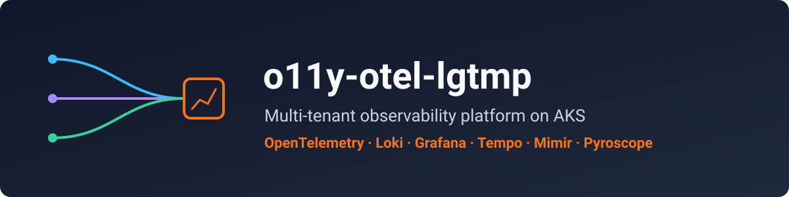
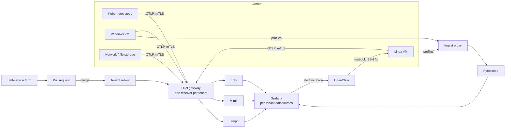

<p align="center">
  
</p>

<p align="center">
  <a href="https://github.com/benschwarz1982/o11y-otel-lgtmp/actions/workflows/ci.yml"></a>
  <a href="LICENSE"></a>
  
  
  
</p>

# o11y-otel-lgtmp

A multi-tenant observability platform on Azure Kubernetes Service:
metrics, logs and traces are collected with
[OpenTelemetry](https://opentelemetry.io/), profiles with Pyroscope
agents, and everything is stored in the Grafana LGTM+P stack - Loki,
Grafana, Tempo, Mimir, Pyroscope - in distributed mode.

Systems are onboarded self-service as tenants with their own data,
budgets, dashboards and alerts. An AIOps agent
([OpenClaw](https://openclaw.ai/)) reacts to alerts and remediates known
problems on its own, following versioned runbooks. Everything - cluster,
stack, demo fleet and instrumentation - is built from code by the
pipeline.

## Contents

- [Features](#features)
- [How it works](#how-it-works)
- [Requirements](#requirements)
- [Quick start](#quick-start)
- [Configuration](#configuration)
- [Usage](#usage)
- [Operations](#operations)
- [Security](#security)
- [Design notes](#design-notes)
- [Limitations](#limitations)
- [Development](#development)
- [Documentation](#documentation)
- [License](#license)

## Features

- **All four signals** - OpenTelemetry Collectors on Kubernetes, Linux
  and Windows VMs, network devices (SNMP) and file storage send metrics,
  logs and traces to one gateway (Mimir, Loki, Tempo); Pyroscope agents
  in the Java and .NET apps on the VMs send continuous profiles through
  an authenticating ingest proxy.
- **Real multi-tenancy** - one tenant per system and environment
  (`<system-id>-<eng|at|prod>`), separated in every backend, with its own
  Grafana datasources, dashboards, alert rules and mTLS receiver on the
  gateway.
- **Self-service lifecycle** - onboarding, update and offboarding through
  a web form; the request becomes a pull request with a validated
  manifest and all generated files, and the merge rolls the tenant out.
- **Budgets and showback** - per-tenant retention, ingestion rate limits
  and a daily ingestion budget derived from size class and environment,
  with early warning and storage showback dashboards.
- **SLOs and alerting as code** - OpenSLO definitions and alert rules are
  generated into per-tenant Mimir ruler rules and unit-tested with
  `promtool`.
- **AIOps remediation** - OpenClaw receives Grafana alerts, fixes them
  autonomously when a matching runbook exists in `sre/runbooks/`, and asks
  a human otherwise.
- **Rebuild from zero** - one workflow run creates network, AKS, the
  stack, the demo fleet and its instrumentation; one run tears it down.

## How it works



1. **Infrastructure** - Terraform creates the network and the AKS cluster
   (`terraform/environments/demo`), then the LGTM+P stack, the OpenTelemetry
   Operator, Traefik and cert-manager with Let's Encrypt via Azure DNS.
2. **Tenants** - each manifest in `manifests/` describes a system (owner,
   cost center, environments, size class). `scripts/provision.py`
   generates the tenant's limits, gateway receiver, datasources,
   dashboards and rules; the tenants workflow applies them.
3. **Fleet** - demo systems run as Kubernetes workloads or as Azure VMs
   (Linux, Windows); Ansible installs and configures the collectors and
   the application-level instrumentation on the VMs.
4. **Ingestion** - clients send OTLP over mTLS through Traefik (TCP, SNI
   passthrough) to their tenant's receiver on the gateway, which enforces
   the tenant's identity and forwards to Loki, Mimir and Tempo. Profiles
   go to Pyroscope through an ingest proxy with per-tenant credentials.
5. **Alerting and remediation** - per-tenant rules fire in Grafana; the
   webhook hands them to OpenClaw, which looks up a runbook and remediates
   over SSH or escalates.

## Requirements

| Component | Requirement |
|---|---|
| Azure | A subscription with one resource group you are **Owner** of (Contributor for the pipeline identity plus one scoped role assignment, see [bootstrap](bootstrap/bootstrap.sh)) |
| DNS | An Azure DNS zone for a subdomain (e.g. `sre.example.com`), delegated from your parent domain |
| Management VM | A small Linux VM in the resource group that hosts the self-hosted runner - the fleet VMs only accept SSH/WinRM from its public IP |
| CI | GitHub Actions (primary) or GitLab CI (alternative) |
| AIOps (optional) | A Claude Pro/Max subscription setup token for OpenClaw |

## Quick start

1. **Azure** - create the DNS zone, `aks-vnet` and the cert-manager service
   principal ([setup, section A](docs/setup.md#a-one-time-bootstrapping-manual)),
   then run the bootstrap as **Owner** of the resource group - in Azure
   Cloud Shell (Bash) or anywhere with the Azure CLI and your own login:
   ```sh
   git clone https://github.com/<owner>/<repo>.git && cd <repo>
   export RG=<resource-group>
   export GITHUB_REPO=<owner>/<repo>
   ./bootstrap/bootstrap.sh
   ```
   It creates the Terraform state storage and an OIDC-federated managed
   identity and prints the settings for the next step
   ([details](docs/github-actions.md#setup)).
2. **GitHub** - create the environment `demo` (deployment branches:
   `main` only) and add the [settings and secrets](#configuration).
3. **Runner** - register the self-hosted runner on the management VM:
   ```sh
   GITHUB_REPO=<owner>/<repo> RUNNER_TOKEN=<token> RUNNER_COUNT=2 ./bootstrap/github-runner.sh
   ```
4. **CI images** - run the *CI images* workflow once and make the
   `ci-tools/*` packages public.
5. **Deploy** - **Actions → Deploy → Run workflow**, scope `everything`.
   Grafana is then at `https://grafana.<dns-zone>`.

Step-by-step details: [docs/github-actions.md](docs/github-actions.md#setup).

## Configuration

Every setting can be a **repository variable** (Settings → Secrets and
variables → Actions → Variables) or a **secret of the `demo` environment**
(Settings → Environments → demo) - the workflows read
`vars.<NAME> || secrets.<NAME>`. Secrets are masked in the public logs,
so resource group, domain and IDs never show up there. Exceptions:
`CI_IMAGE_PREFIX` and `SELF_SERVICE_APP_ID` must be variables (GitHub
does not allow secrets where they are used).

| Setting | Required | Description |
|---|---|---|
| `AZURE_RESOURCE_GROUP` | yes | Resource group everything is deployed into |
| `DNS_ZONE` | yes | Azure DNS zone of the public hostnames, e.g. `sre.example.com` |
| `AZURE_TENANT_ID`, `AZURE_SUBSCRIPTION_ID` | yes | Printed by `bootstrap.sh` |
| `AZURE_CLIENT_ID` | yes | Client ID of the deploy identity `id-otel-demo-deploy`, printed by `bootstrap.sh` |
| `TFSTATE_RESOURCE_GROUP`, `TFSTATE_STORAGE_ACCOUNT`, `TFSTATE_CONTAINER` | yes | Terraform state location, printed by `bootstrap.sh` (container `tfstate`) |
| `CERT_MANAGER_CLIENT_ID` | yes | cert-manager service principal (DNS-01 challenges) |
| `ACME_EMAIL` | no | Let's Encrypt contact address; default none |
| `OPENCLAW_MODEL`, `AGENT_NAME`, `ORGANISATION_NAME`, `OPERATOR_NAME` | no | OpenClaw model and identity strings |
| `CI_IMAGE_PREFIX` | no, variable only | Default `ghcr.io/<owner>/<repo>/ci-tools` |
| `SELF_SERVICE_APP_ID` | no, variable only | GitHub App for self-service pull requests (with secret `SELF_SERVICE_APP_PRIVATE_KEY`) |

**Secrets** (environment `demo`, always secrets):

| Secret | Used by |
|---|---|
| `CERT_MANAGER_CLIENT_SECRET` | observability stack |
| `GRAFANA_ADMIN_PASSWORD` | observability stack |
| `OPENCLAW_HOOKS_TOKEN` | observability stack, aiops |
| `OPENCLAW_GATEWAY_TOKEN` | tenants, aiops |
| `ANTHROPIC_SETUP_TOKEN` | aiops |

## Usage

### GitHub Actions

| Workflow | Trigger | Does |
|---|---|---|
| **CI** | pull request, push to `main` | Lints workflows, YAML, shell, Python, Ansible, Terraform, Dockerfile and Kubernetes manifests; validates manifests and generated files; tests alert/SLO rules; scans for secrets and misconfigurations |
| **Deploy** | manual | `everything` or one scope: infra, observability-stack, tenants, fleets, instrumentations, aiops; optional system filter and plan-only |
| **Destroy** | manual, confirm with `destroy` | Reverse order of Deploy |
| **Tenants** | merge touching tenant config | Verifies the generated files, rolls out tenants |
| **Self-service request** | issue from the form | Turns the request into a pull request |
| **Demo** | manual | Break/fix of the four demo use cases |
| **Infra plan**, **CI images**, **Pages**, **Security scans** | path filters / weekly | Plan of the AKS environment, CI tool images with provenance, form publishing, weekly CVE scans |

Every workflow and the mapping to the GitLab jobs:
[docs/github-actions.md](docs/github-actions.md).

### Self-service

The form (GitHub Pages) collects the request - system ID, type, owner,
cost center, environments, size class, dashboard template - and opens a
prefilled issue. The *Self-service request* workflow validates it and
opens a pull request with the manifest and every generated file; merging
it rolls the tenant out. Details: [docs/self-service.md](docs/self-service.md).

### GitLab CI (alternative)

`.gitlab-ci.yml` provides the same pipeline with manual jobs per step and
the GitLab-managed Terraform state. Moving the project to GitLab:
[docs/gitlab-ci.md](docs/gitlab-ci.md).

## Operations

- **Teardown** - **Actions → Destroy**, scope `everything`. The DNS zone,
  `aks-vnet` and the management VM stay
  ([details](docs/operations.md#destroy)).
- **Scheduled scans** - weekly `pip-audit` and Trivy runs catch new CVEs
  without a repository change.
- **Updates** - versions are pinned everywhere (actions by commit SHA,
  charts, images, tools) and updated deliberately; there is no automated
  dependency bot.
- **Demo** - four use cases (Linux CPU saturation, Windows service crash,
  microservice latency, ingestion budget enforcement) with break/fix
  runbook: [docs/demo.md](docs/demo.md).

## Security

- **No stored deployment credentials** - the pipeline signs in to Azure
  via GitHub OIDC to a managed identity that only trusts the `demo`
  environment on `main`; Terraform state in Azure Storage with shared-key
  access disabled. The one remaining long-lived credential is the
  cert-manager service principal secret for DNS-01 challenges, kept as an
  environment secret and a Kubernetes secret.
- **Least privilege** - Contributor on one resource group; the only role
  the identity may grant is Network Contributor on `aks-vnet`, enforced by
  an ABAC condition. Workflows start with `permissions: {}`.
- **mTLS ingestion** - each tenant has its own mTLS receiver on the
  gateway (certificates from the platform's internal CA), and the gateway
  rejects tenants that are not onboarded.
- **Secrets** - pipeline secrets come from GitHub environment secrets;
  in the cluster, secrets are mounted from Azure Key Vault (Secrets Store
  CSI driver) or kept in Kubernetes secrets - never in the repository.
  Sensitive log fields are masked before storage.
- **Network** - fleet VMs accept SSH/WinRM only from the management VM;
  host keys and the WinRM certificate are pinned; OpenClaw's egress is
  limited by network policies.
- **Supply chain** - actions pinned by commit SHA, CI images with SBOM and
  build provenance attestations, workflows audited with zizmor, secret
  scanning with gitleaks.
- **Accepted trade-offs** of this demo setup (self-hosted runner on a
  public repository, identity inside its own scope):
  [docs/github-actions.md](docs/github-actions.md#accepted-risks-demo-trade-offs).

## Design notes

**Tenant per system and environment.** Tenants are named
`<system-id>-<env>`, so retention, budgets and access follow the
environment (Eng 10 days, AT/Prod 30 days) without separate clusters.
The system ID is a four-digit number from the architecture inventory; it
also derives the tenant's receiver port on the gateway.

**Generated, reviewed configuration.** Manifests are the only input.
Limits, gateway receivers, datasources, dashboards and rules are
generated and committed with the request, so every tenant change is a
reviewable diff, and CI fails if generated files drift from their
manifests.

**Rate limit and daily budget are separate.** The ingestion rate limit
protects the backends from bursts; the daily budget (size class × days)
is what the tenant pays for. A tenant that exhausts its budget is
throttled until the daily reset.

**Two CI systems, one code base.** Terraform, Ansible, the provisioning
scripts and the CI images are shared; GitHub Actions and GitLab CI each
orchestrate them in their own way (`ci/scripts/` for GitHub, inline jobs
in `.gitlab-ci.yml`). The Terraform state backend differs.

**Self-hosted runner for the fleet.** GitHub-hosted runners have changing
IPs; opening the fleet NSGs to them would undo the management-IP
restriction, so deploy jobs run on a runner on the management VM inside
the CI tool images.

## Limitations

- A demo environment: one AKS cluster, sized for cost, not for production
  load or high availability.
- One platform at a time per environment - GitHub Actions and GitLab CI
  keep separate Terraform states.
- Destroy only soft-deletes the Key Vault (the identity cannot purge); the
  name expires after 7 days, a rebuild uses a new name.
- Baggage-based correlation IDs are not copied onto spans by the demo
  shop's services, so they are not searchable in Tempo.
- [docs/known-pitfalls.md](docs/known-pitfalls.md) lists the operational
  pitfalls found while building the platform.

## Development

```sh
python3.15 -m venv .venv && . .venv/bin/activate
pip install -r ci/requirements/python-lint.txt -r ci/requirements/onboarding.txt
ruff check .
python3 scripts/validate-manifests.py
python3 scripts/provisioning_sync.py --check   # generated files up to date
terraform fmt -check -recursive terraform
```

Rule tests (`scripts/test-rules.py`) need `promtool` and `sloth` from the
CI image (`ci/images/Dockerfile`).

| Path | Purpose |
|---|---|
| `terraform/` | Environments (infra, observability stack, tenants, fleets, aiops) and modules |
| `ansible/` | Collector and middleware instrumentation for the VMs |
| `helm/values/` | LGTM+P, OpenTelemetry Operator, Traefik values |
| `collector-gateway/`, `instrumentation/` | Gateway and per-system collector configurations |
| `manifests/`, `form/` | Tenant manifests (JSON Schema) and the self-service form |
| `scripts/` | Provisioning, rule generation, self-service, budget tools |
| `alerting/`, `slo/`, `rules/` | Alert rules, OpenSLO definitions, generated ruler rules |
| `dashboards/`, `datasources/` | Grafana dashboards and per-tenant datasources |
| `openclaw/`, `sre/runbooks/` | AIOps agent configuration and its runbooks |
| `app/` | Source of the demo applications |
| `ci/`, `bootstrap/`, `.github/` | CI images and scripts, one-time setup, workflows |

## Documentation

| Document | Content |
|---|---|
| [docs/github-actions.md](docs/github-actions.md) | Workflows, design, setup, GitLab mapping |
| [docs/setup.md](docs/setup.md) | Bootstrapping and every deployment step in detail |
| [docs/self-service.md](docs/self-service.md) | Onboarding, update and offboarding |
| [docs/platform-features.md](docs/platform-features.md) | Masking, SLOs, anomalies, showback, tiering, Key Vault, budgets |
| [docs/demo.md](docs/demo.md) | Use cases and presenter runbook |
| [docs/operations.md](docs/operations.md) | Scheduled scans, teardown |
| [docs/gitlab-ci.md](docs/gitlab-ci.md) | Running on GitLab CI |
| [docs/known-pitfalls.md](docs/known-pitfalls.md) | Pitfalls and their fixes |

## License

[MIT](LICENSE)
